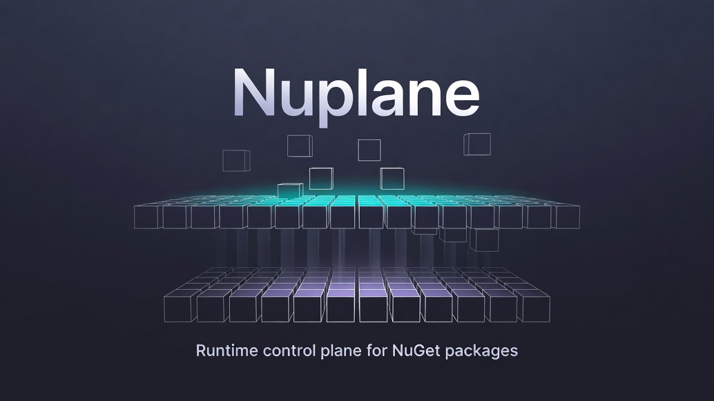

# Nuplane

Nuplane is a runtime control plane for NuGet packages. It lets your .NET application install, update, and load NuGet packages **while it is running** — no restart required.

Drop a `.nupkg` into a watched folder or point Nuplane at a NuGet feed. It resolves the package, extracts it to a deterministic local store, loads the assemblies into an isolated context, and signals your host. Your host decides what to do with the loaded types.

## What you can build

The most immediate use case is **dynamic NuGet package installation into a live .NET application**:

- **Hot-reload plugin systems** — ship plugins as NuGet packages; drop them into a local feed folder at runtime and have them discoverable in the live app within seconds.
- **Modular feature delivery** — split an application into independently versioned feature packages and update individual features at runtime without a full redeployment.
- **SaaS per-tenant extensions** — load per-tenant behaviour packages at runtime; each tenant gets their customizations without shared hosting risk.
- **Workflow and rule engines** — deploy new steps, validators, or rules as packages and pick them up live without restarting the engine.
- **Internal tool hosts** — extend internal platforms dynamically by pushing a new package to a watched folder; the host picks it up automatically.

See the [End-to-End ASP.NET Plugin Demo](#end-to-end-aspnet-plugin-demo) below for a full walkthrough of the drop-folder workflow with a live ASP.NET Core host.

Nuplane handles the infrastructure: feed resolution, deterministic storage, transactional updates, last-known-good fallback, isolated assembly loading, and structured change events. Your host decides what the loaded packages mean.

Nuplane 1.x targets .NET 10 LTS. If your host targets .NET 8 or 9, upgrade it to .NET 10 before moving to Nuplane 1.0. See the [0.0.16 migration notes](https://github.com/valence-works/nuplane/releases/tag/0.0.16) when upgrading from 0.0.15 or earlier.

## 📖 Start With The Wiki

If you are evaluating or onboarding to Nuplane, start with the repository-owned wiki under [`docs/wiki/`](docs/wiki/):

- [`Home`](docs/wiki/Home.md) — product framing and audience routes
- [`Overview`](docs/wiki/Overview.md) — why Nuplane exists, what it does, and what it does not do
- [`Getting Started`](docs/wiki/Getting-Started.md) — recommended first-use path
- [`Usage Guide`](docs/wiki/Usage-Guide.md) — core-runtime vs optional-loading usage guidance
- [`Architecture Guide`](docs/wiki/Architecture-Guide.md) — module map and repository-to-concept view
- [`Concepts and Glossary`](docs/wiki/Concepts-and-Glossary.md) — normalized terminology
- [`Manual package-store maintenance`](docs/package-store-maintenance.md) — optional coordinated enrollment, migration, inspection and pruning

The wiki follows a **hybrid-hub** model: it is self-sufficient for evaluation and onboarding, while deeper validation details, roadmap history, sample mechanics, and other fast-moving reference material remain repository-owned.

---

## ✨ What Nuplane Does

- Resolve packages from NuGet v3 feeds
- Support `.nupkg` local directory feed deployment
- Maintain a deterministic on-disk package store
- Reconcile desired vs actual package state
- Apply atomic per-package updates
- Provide last-known-good (LKG) fallback
- Emit structured change events for host integration
- Verify acquired archives against package lock provenance
- Provide operational visibility (logs, metrics, health)

---

## 🚫 What Nuplane Does Not Do

- It does not define a plugin entrypoint model.
- It does not mutate your DI container.
- It does not impose activation semantics.
- It does not guarantee in-process assembly unload.
- It does not sandbox untrusted code.

Nuplane is infrastructure. Your host decides what to do when packages change.

---

## 🧠 Core Concept

Nuplane implements a simple control loop:

1. Determine **desired packages**
2. Compare with **current state**
3. Compute a diff
4. Apply transactional updates
5. Emit change events

Hosts (e.g., web apps, workers, modular systems) react to change events by reloading, rescanning, or reconfiguring as needed.

---

## 📚 Terminology and Concepts

### Desired state

The set of packages Nuplane should make active.
Desired state comes from configured sources, such as remote feeds, directory-backed feeds, or other desired-state providers.

When more than one desired source contributes the same package ID, configure source precedence under
`Nuplane:DesiredState:SourcePriorities`. Lower numbers win and an unlisted source has the lowest
precedence (`int.MaxValue`). Source names are matched case-insensitively, and the name used here is
the `PackageRequest.SourceName` emitted by the source. A directory registration sets that source name
to its feed name, while a custom source can use a different stable name. Priority keys must contain
a source name. You can configure a name before that source emits its first request.

```json
{
  "Nuplane": {
    "DesiredState": {
      "SourcePriorities": {
        "renewal-demo-updates": 0,
        "renewal-demo-baseline": 10
      }
    }
  }
}
```

In a configuration-driven host, the builder callback runs after binding and can override configured
priorities:

```csharp
using Nuplane;
using Nuplane.Sources.Configuration;

services.AddNuplane(configuration.GetSection("Nuplane"), nuplane =>
{
    nuplane.Services.Configure<DesiredStateOptions>(options =>
    {
        options.SetPriority("renewal-demo-updates", 0);
        options.SetPriority("renewal-demo-baseline", 10);
    });
});
```

For code-only setup, omit the configuration argument and keep the same callback.

For a duplicate ID, Nuplane selects the request with the lowest source priority, then uses the
existing case-insensitive `SourceName` and `VersionRange` ordering, followed by deterministic feed,
update-policy, and casing tie-breaks. The selected `PackageRequest` remains intact. This policy only
resolves overlap in desired state: feed priorities still control feed candidate ordering, and source
admission, trust checks, package resolution, fallback behavior, and semantic version selection remain
their own stages. `FeedResolution:FeedPriorities` does not implicitly set source priorities, and Nuplane
does not compare semantic versions across sources. For example, a higher-priority exact `1.0.0` request
remains the winner over a lower-priority source's newer `1.1.0` request. With no priorities, existing
case-insensitive source-name ordering remains the default.

Desired-state snapshots and outage diagnostics identify each registered source instance. Built-in
feeds and directories use their configured names. If a host registers multiple instances of a custom
source type, implement `IIdentifiedDesiredPackageSource` with a unique `SourceInstanceId` that stays
stable across restarts. This ID is independent of the `PackageRequest.SourceName` used for source
priority. A legacy type-keyed snapshot can provide fallback if its saved requests identify the
current built-in source. On a successful read Nuplane stores the new instance snapshot, even if
the source returns zero packages.

### Actual state

The packages currently installed and active in the local package store.
Nuplane compares actual state with desired state during each reconciliation cycle.

### Feed

A named package source Nuplane can resolve from.
A feed can point at a NuGet v3 service index or at a local directory containing `.nupkg` files.
Feeds can also define trust level, credentials, and include patterns.
A private feed's credentials are a `secrets://<provider>/<name>` reference — never the secret itself — resolved at runtime by a registered provider, with a built-in `env` provider reading `secrets://env/MY_FEED_TOKEN` from the process environment; see [Usage Guide: Feed credentials](docs/wiki/Usage-Guide.md#feed-credentials).

### Include pattern

A package ID filter applied to a feed.
For example, `MyApp.Plugins.*` means that feed is authoritative for matching package IDs only.
These patterns also inform source/package trust defaults unless you explicitly override trust options.

### Directory-backed feed

A local folder treated as a feed.
Nuplane can scan it for `.nupkg` files and optionally watch it for file changes with debounce.
This is what powers the sample's drop-folder workflow.
The folder itself is only read: packages resolved from it are extracted under `FeedResolution:PackageInstallRoot`,
so a pre-populated package folder can be mounted read-only (`-v "$(pwd)/packages:/app/packages:ro"`).

### Reconciliation

A control-loop cycle where Nuplane:

- reads desired state
- resolves package versions from feeds
- computes the diff versus actual state
- applies transactional add/update/remove operations
- emits observer events and operational telemetry

Reconciliation can be manual, startup-triggered, or periodic.

### Package store

Nuplane's deterministic on-disk storage area for downloaded packages, staging work, and persisted state.
File-backed hosts use the configured state file, `store-state.json` by default, as the authority for active versions and last-known-good state across restarts.

### Active version

The version Nuplane currently considers live for a package in the local store.
This is the version your host should treat as the current runtime target.

### Last-known-good (LKG)

The most recent version Nuplane successfully applied for a package. With automatic loading enabled, a replacement graph must load before it becomes the active and last-known-good graph. If loading fails, Nuplane keeps the previous graph and reports a degraded cycle.

### Observer

A host-owned callback type registered in DI.
Nuplane emits events such as package-change completion or package-loading completion, and your observers decide what the application should do in response.

### Optional loading

An opt-in subsystem that loads resolved packages into assembly load contexts.
Call `AutoloadPackages` from `Nuplane.Loading` to register and enable it. Set `Nuplane:Loading:Enabled` to `false` to register the query surfaces while leaving loading disabled.
Nuplane supports two package load modes:

- `Collectible` is the default mode for isolated or scan-only plugin scenarios where package assemblies should remain unloadable when references drain.
- `HostIntegrated` is for packages that contribute application-lifetime framework types such as DI registrations, endpoints, hosted services, options, validators, or database migrations.

Shared assemblies remain a separate policy: they solve contract/type identity by resolving selected abstractions from the host/default context, but they do not by themselves make package assemblies framework-integrated or resolvable by name.
Nuplane can manage shared contract assemblies, deactivation timeout, unload coordination for collectible packages, and host-integrated assembly-name resolution, but your host still decides what loaded types mean.

Load mode can be selected automatically. Nuplane resolves package graphs first, evaluates load-mode advisors, and promotes a graph to `HostIntegrated` when a package declares a host-integration requirement. Explicit `PackageLoadModes` overrides remain authoritative, and packages without overrides or metadata keep using `DefaultLoadMode`.

Package authors can declare Nuplane loading metadata once in package-root `nuplane.json`:

```json
{
  "schemaVersion": 1,
  "loading": {
    "loadMode": "HostIntegrated",
    "scope": "DependencyClosure",
    "reason": "Uses framework type resolution and runtime scheduler integration."
  }
}
```

Nuplane reads this metadata only from packages that have already been resolved and installed through the configured source and integrity paths. Metadata is trusted only as much as the package itself; it does not bypass source trust, package validation, or host-owned activation decisions.

Schema 2 of the same file adds `capabilities`: a package declares a named choice of root package it needs at run time but does not depend on — which database engine, for example — the host picks one with `Nuplane:Capabilities:<name>`, and that option's package is resolved as an ordinary root; a capability no host has selected is refused rather than guessed at. See [Selecting a package capability](docs/wiki/Usage-Guide.md#selecting-a-package-capability) and [Package Authoring](docs/wiki/Package-Authoring.md#capability-metadata).

A host can also refuse activation outright. A registered `IPackageActivationGate` is consulted for each package graph that is about to load — after the load mode is decided and before any load context exists — and can return `Block(reason)` to stop that graph. A block fails every package in that graph as an ordinary load failure and leaves other graphs alone; gates are fail-closed, so a gate that throws also blocks; and a blocked graph is re-evaluated on the next attempt. This is what keeps a process restart or reconcile from silently reactivating a package whose host-side pre-condition, such as a database schema version, is no longer met.

### Module registration

Core `AddNuplane` registers the runtime and configured feeds. Add the `Nuplane.Loading` package and
call `AutoloadPackages` when the host should load assemblies. Loading is enabled when called unless
`Nuplane:Loading:Enabled` is explicitly set to `false`. For HTTP administration, install
`Nuplane.Admin.Api`, register `AddNuplaneAdmin`, and map `MapNuplaneAdmin`. The separate
`Nuplane.Loading.Api` package maps the optional load-state route.

### Configuration-driven setup

A way to declare Nuplane infrastructure in configuration instead of code.
`Nuplane:Setup:Feeds` declares feeds. Use `Nuplane:Reconciliation` for polling, `Nuplane:StoreRegistry` for state-file persistence, and `Nuplane:Loading` for optional runtime loading.
Observer registration and other host-specific reactions stay in code.

---

## 📦 Quick Start

In an ASP.NET Core project, reference the `Nuplane` and `Nuplane.Loading` packages at the same
version. Put the configuration below in `appsettings.json`.

```csharp
using Nuplane;
using Nuplane.Abstractions;
using Nuplane.Loading;

var builder = WebApplication.CreateBuilder(args);
var configuration = builder.Configuration.GetSection("Nuplane");

builder.Services.AddNuplane(configuration, nuplane =>
{
    nuplane.UseBasePath(builder.Environment.ContentRootPath);
    nuplane.AutoloadPackages(configuration);
    nuplane.OnPackagesChanged<PackageChangeObserver>();
});

var app = builder.Build();
app.Run();

public sealed class PackageChangeObserver(ILogger<PackageChangeObserver> logger) : INuplaneObserver
{
    public Task OnPackagesChangedAsync(PackageChangeSet changeSet, CancellationToken cancellationToken)
    {
        logger.LogInformation("Nuplane reconciled package changes for {CorrelationId}", changeSet.CorrelationId);
        return Task.CompletedTask;
    }
}
```

```json
{
  "Nuplane": {
    "Reconciliation": {
      "EnableAutomaticReconciliation": true,
      "PollInterval": "00:01:00"
    },
    "Setup": {
      "Feeds": {
        "local-packages": {
          "DirectoryPath": "packages",
          "Trust": "Trusted",
          "IncludePatterns": [
            "*"
          ],
          "Directory": {
            "Watch": true,
            "DebounceWindow": "00:00:01"
          }
        },
        "nuget.org": {
          "ServiceIndex": "https://api.nuget.org/v3/index.json",
          "Trust": "Trusted",
          "IncludePatterns": [
            "Elsa.*"
          ]
        }
      }
    },
    "Loading": {
      "Enabled": true,
      "DefaultLoadMode": "Collectible",
      "LoadModeSelectionPolicy": "Automatic",
      "PackageLoadModes": [
        {
          "PackageId": "Elsa.Persistence.EFCore.PostgreSql",
          "LoadMode": "HostIntegrated"
        }
      ],
      "SharedAssemblies": [
        {
          "Name": "Nuplane.Abstractions",
          "PublicKeyToken": "31bf3856ad364e35",
          "MajorVersion": 1
        }
      ]
    }
  }
}
```

When packages are added, updated, or removed, Nuplane emits `PackageChangeSet` events for your host to react to.

### Query-first catalog access

Observers are supplemental invalidation and logging signals. For authoritative reads, query the standalone catalog services directly:

The [sample's endpoint mappings](samples/Nuplane.Sample.AspNetCore/Program.cs) show how a host can
expose these reads over HTTP.

- Use `IActivePackageCatalog.GetActivePackagesAsync(ct)` when you only need the authoritative active package inventory from inside a running host.
- Use `NuplaneStore.ReadActivePackagesAsync(stateFilePath, ct)` when you need the same active package id/version/install-path data without a running host, a DI container, or network access — see [Usage Guide: Offline reads of the active package set](docs/wiki/Usage-Guide.md#offline-reads-of-the-active-package-set).
- Use `NuplaneHostIntegratedLoader.LoadFromStateAsync(stateFilePath, options, ct)` — or its `StoreRegistryOptions` overload — when a short-lived worker process must load the host's active package set into assemblies exactly the way that host's `HostIntegrated` loading does: same graph grouping, same load contexts, same asset selection, same `Default.Resolving` hook, without a running host.
- Use `NuplaneHostIntegratedLoader.LoadActivePackagesAsync(activePackages, options, ct)` when the caller assembles or filters the package set itself; it groups by graph generation identity, which is all an `ActivePackage` carries, so only `LoadFromStateAsync` guarantees the host's grouping. Either way the load is irreversible for the process; see [Usage Guide: Host-free loading of the active package set](docs/wiki/Usage-Guide.md#host-free-loading-of-the-active-package-set).
- Use `NuplaneRestore.RestoreAsync(configuration, options, ct)` when out-of-process tooling must populate a never-started host's install root and store from that host's own configuration: one reconciliation cycle, no host, nothing loaded, and the resolved state file and install root reported back so the caller can prove where it wrote. Use `NuplaneRestore.DescribeDesiredAsync(configuration, options, ct)` for the side-effect-free, network-free pre-flight that lists what a restore would ask for and whether each request is a single-point pin. See [Usage Guide: Host-free restore of the package set](docs/wiki/Usage-Guide.md#host-free-restore-of-the-package-set).
- Use `IPackageLoadStateCatalog.GetLoadStateAsync(ct)` when the optional loading module is installed and you need current-process load-state availability or per-package load status.
- Use `IPackageAssemblyCatalog` as the default loading-enabled host integration surface when you want sane-default access to loaded `Assembly` instances for the current active package set without manually filtering load-state snapshots first.
- Use `IPackageAssemblyCatalog.GetAssembliesAsync(packageId, ct)` when you want the currently active loaded version for one package identifier.
- Use `IPackageTypeFinder.FindTypesAsync(packageId, ct)` only as an optional convenience after assembly access when you want Nuplane to apply assignability-based filtering over the current active loaded version for one package.
- Use a host-owned query service such as the sample `PluginCatalog` when you want to explicitly discover all `IPlugin` implementations from the current active loaded package set while keeping package-aware control over the discovery flow.
- In the sample HTTP payloads for `/catalog/assemblies` and `/catalog/assemblies/{packageId}`, `loadedAssemblies` is the runtime-loaded assembly view while `selectedAssemblyReferences` is the durable loader-selected metadata view.
- Use the admin API (`/nuplane/admin/packages`, `/nuplane/admin/load-state`, `/nuplane/admin/state`) when you want HTTP access to the same composed read surfaces.

#### Clean-break notes for query surfaces

- `GET /nuplane/admin/load-state` is owned by `Nuplane.Loading.Api`, not by the core admin packages.
- `GET /nuplane/admin/snapshot` is intentionally removed; package inventory and operational state are now separate reads.
- The sample's `/catalog/packages`, `/catalog/load-state`, `/catalog/assemblies`, and `/catalog/plugins` endpoints intentionally teach the default host decision tree in that order: active packages, load state, assemblies, then optional type finding.
- The sample observers demonstrate cache invalidation and logging only; they are not the authoritative package/loading inventory source.
- These surface changes are intentional breaking changes for hosts that previously depended on merged snapshot or core-admin loading compatibility payloads.

### Configuration model

Each part of Nuplane has its own configuration section.

- `Nuplane:Setup:Feeds` declares feeds, include patterns, and directory watcher settings.
- existing runtime option sections under `Nuplane:*` — advanced operator configuration:
  - `DesiredState`
  - `Reconciliation`
  - `FeedResolution`
  - `SourceTrust`
  - `FeedTrustPolicy`
  - `LockFile`
  - `CleanupPolicy`
  - `DesiredState:Manifest`
  - `TrustedSourcePolicy`
  - `StoreRegistry`
- `Nuplane:Loading` — optional loading settings:
  - `Enabled`
  - `DeactivationTimeout`
  - `ActiveStoreRoot`
  - `DefaultLoadMode`
  - `LoadModeSelectionPolicy`
  - `PackageLoadModes`
  - `SharedAssemblies`

Automatic reconciliation is opt-in via `Nuplane:Reconciliation:EnableAutomaticReconciliation` and
polls every 60 seconds unless you set `Nuplane:Reconciliation:PollInterval`. For persistence, choose
either `Nuplane:StoreRegistry:StateFilePath` or `Nuplane:StoreRegistry:UseInMemoryStore`.
Builder calls in the `AddNuplane` callback run after binding, so `PollEvery(...)`, `WithStateFile(...)`,
and `UseInMemoryStore()` can override configuration.

Older `Setup` keys fail startup validation. Migrate them as follows.

| Old key | Replacement |
| --- | --- |
| `Setup:AutomaticReconciliation` | `Reconciliation:EnableAutomaticReconciliation` |
| `Setup:PollInterval` | `Reconciliation:PollInterval` |
| `Setup:StateFilePath` | `StoreRegistry:StateFilePath` |
| `Setup:UseInMemoryStore` | `StoreRegistry:UseInMemoryStore` |

Directory-backed feeds are part of the core `Nuplane` package. Remove the old
`Nuplane.Sources.Directory` package reference and the separate directory configuration call when
upgrading. Use `Nuplane:Setup:Feeds` for configuration or `AddDirectoryFeed(...)` from
`Nuplane.Sources.Directory.Builder` for code-first registration.

For unrestricted feeds, prefer one of these explicit forms:

- configuration: `"IncludePatterns": ["*"]`
- configuration alias: `"IncludeAll": true`
- fluent API: `feed.IncludeAll()`

For configuration-driven setup, prefer the keyed `Nuplane:Setup:Feeds` object shape:

```json
"Feeds": {
  "feedz.io": {
    "ServiceIndex": "https://new.example/nuget/index.json"
  }
}
```

The feed key is the feed name. This shape is preferred for layered .NET configuration because later providers can override `Feeds:feedz.io` by identity instead of merging array entries by numeric position. Feed object order is not semantic; use `DesiredState:SourcePriorities` for overlapping desired requests and `FeedResolution:FeedPriorities` for feed resolution candidates.

Migration from the legacy array shape is mechanical:

```json
"Feeds": [
  {
    "Name": "feedz.io",
    "ServiceIndex": "https://old.example/nuget/index.json"
  }
]
```

becomes:

```json
"Feeds": {
  "feedz.io": {
    "ServiceIndex": "https://new.example/nuget/index.json"
  }
}
```

---

## Kubernetes And Restart Persistence

Nuplane keeps runtime state and extracted packages on disk. If a pod restarts with an empty filesystem, Nuplane will need to reconcile and acquire packages again.

To avoid that, persist both of these paths on a mounted volume:

- the package install root
- the store state file

Recommended approach:

- use one persistent volume per replica
- mount it at a stable path such as `/var/lib/nuplane`
- configure package extraction under `/var/lib/nuplane/packages`
- configure store state at `/var/lib/nuplane/store-state.json`

Example configuration:

```json
{
  "Nuplane": {
    "StoreRegistry": {
      "StateFilePath": "/var/lib/nuplane/store-state.json"
    },
    "Reconciliation": {
      "EnableAutomaticReconciliation": true,
      "PollInterval": "00:01:00"
    },
    "Setup": {
      "Feeds": {
        "nuget.org": {
          "ServiceIndex": "https://api.nuget.org/v3/index.json",
          "Trust": "Trusted",
          "IncludePatterns": [
            "*"
          ]
        }
      }
    },
    "FeedResolution": {
      "PackageInstallRoot": "/var/lib/nuplane/packages"
    }
  }
}
```

Operational guidance:

- prefer a per-replica persistent volume, not a single shared read-write-many package store across replicas
- for Kubernetes, a `StatefulSet` with one volume per replica is the best fit when warm restarts matter
- if `UseInMemoryStore=true` is enabled, restart persistence is intentionally disabled
- if `PackageInstallRoot` is not persisted, Nuplane may need to download and extract packages again after pod restart even if the store state file is preserved
- `PackageInstallRoot` must be writable; it is the only package location Nuplane writes to, so feed directories supplying `.nupkg` files can stay read-only

With both paths persisted, a restarted pod can typically reload prior active state and reuse previously extracted packages instead of rebuilding its local package store from scratch.

Example `StatefulSet` sketch:

```yaml
apiVersion: apps/v1
kind: StatefulSet
metadata:
  name: nuplane-host
spec:
  serviceName: nuplane-host
  replicas: 2
  selector:
    matchLabels:
      app: nuplane-host
  template:
    metadata:
      labels:
        app: nuplane-host
    spec:
      containers:
      - name: app
        image: your-registry/nuplane-host:latest
        volumeMounts:
        - name: nuplane-data
          mountPath: /var/lib/nuplane
        env:
        - name: Nuplane__Setup__StateFilePath
          value: /var/lib/nuplane/store-state.json
        - name: Nuplane__FeedResolution__PackageInstallRoot
          value: /var/lib/nuplane/packages
  volumeClaimTemplates:
  - metadata:
      name: nuplane-data
    spec:
      accessModes:
      - ReadWriteOnce
      resources:
        requests:
          storage: 10Gi
```

This keeps each replica's package cache and persisted state warm across pod restarts while avoiding a shared multi-writer package store.

Storage planning notes:

- size the PVC for more than just the currently active package set; leave headroom for staged downloads, retained previous versions, and transient extraction work
- Nuplane may keep prior package versions on disk to preserve transactional safety and last-known-good behavior
- if you enable cleanup policies, align retention settings with your rollback expectations and available disk budget
- if you do not enable cleanup, expect disk usage to grow over time as new package versions are acquired

> Breaking change: omitted include filters no longer mean “accept everything.”
> A feed without `IncludePatterns`, `IncludeAll`, or `feed.IncludeAll()` now contributes no packages.

### Configuration vs code

Use configuration for infrastructure and policy:

- feeds
- polling and persistence
- loading options
- trust and resolution settings

Keep application-specific behavior in code:

- `OnPackagesChanged<T>()`
- any logic that decides how your host reacts to package changes

### Fluent builder still works

If you prefer code-first setup, the fluent API remains available:

```csharp
using Nuplane;
using Nuplane.Abstractions;
using Nuplane.Sources.Directory.Builder;

builder.Services.AddNuplane(nuplane =>
{
    nuplane.PollEvery(TimeSpan.FromSeconds(60));
    nuplane.AddDirectoryFeed("local-packages", "packages", dir =>
    {
        dir.Trust = FeedTrustLevel.Trusted;
        dir.Watch = true;
        dir.DebounceWindow = TimeSpan.FromSeconds(1);
        dir.IncludeAll();
    });
});
```

---

## 🗂 Package Store Layout

Every feed kind installs under the one writable `PackageInstallRoot`:

```
<PackageInstallRoot>/
  <feed>/<packageId>/<version>/
    ...extracted package files...
    .nuplane-archive        the exact .nupkg acquired from the feed
    .nuplane-content-hash   sha512:<base64> of that archive
    .nuplane-ready          completion marker, written last
  .tmp/                     ordinary staging
```

The persisted state file (`Nuplane:StoreRegistry:StateFilePath`) records the active version and
descriptor of each package. It also records the archive hash of every package version it has activated.

Updates are atomic:

* Download or copy the archive into staging
* Hash it, then extract it
* Publish the complete install directory with one rename
* Switch the active version and persist state

If anything fails, the previous version remains active. An install directory is immutable once
published, and the kept archive shares its lifetime: pruning removes the archive only with its install,
and never removes an active, last-known-good or in-use install.

### Reading package content

`IPackageArchiveReader` (namespace `Nuplane.PackageArchives`) serves an active package's files from its
kept archive. `AddNuplane` registers it for every composition, with or without an enrolled coordinated store:

```csharp
using Nuplane.Abstractions;
using Nuplane.PackageArchives;

static async Task<byte[]?> ReadModuleAsync(
    IActivePackageCatalog catalog,
    IPackageArchiveReader archives,
    CancellationToken cancellationToken)
{
    const long maximumEntryBytes = 1024 * 1024;
    var snapshot = await catalog.GetActivePackagesAsync(cancellationToken);
    var package = snapshot.Packages.SingleOrDefault(p => p.PackageId == "Acme.Addon");
    if (package is null)
        return null;

    var archive = await archives.OpenAsync(package, cancellationToken);
    return archive.GetEntry("staticwebassets/module.js") is { Length: <= maximumEntryBytes } entry
        ? entry.ReadAllBytes()
        : null;
}
```

* The reader reads the archive into memory, computes its sha512 and compares it with
  `ActivePackage.ArchiveHash`. Only bytes that match are served.
* Nuplane records a package version's hash in the state file the first time it becomes active, from the
  hash computed when its archive was acquired. It keeps that record, including after the version is
  deactivated, keyed by package ID and version. A restart, a reconciliation, a rollback to a retained
  install, another feed serving the same version, or the install root reached through another spelling is
  verified against that record, so replacing an archive together with the hash file beside it is refused.
  The same version with different bytes from any feed is refused; publish a new version instead.
* On a cold load, a modified, replaced, truncated or missing archive is refused with `PackageArchiveException`, which
  names the package, the version and a `Reason` (`HashNotRecorded`, `ArchiveMissing`, `ArchiveUnreadable`,
  `ArchiveTooLarge`, `HashMismatch` or `InvalidArchive`). A refusal is logged as a warning when it is
  made; repeats within the five seconds it is remembered are not logged again.
* It works on any filesystem that can store a file. CI qualifies it on Linux overlayfs (a container's
  writable layer), xfs, btrfs, tmpfs and ext4, macOS, and Windows x64 and arm64, all without an enrolled
  store.
* The reader exposes valid, unambiguous file entries. It treats `/` and `\` as separators in ZIP names
  and lookup paths. Lookups are case-insensitive and reject rooted paths, empty, `.` or `..` segments, `:`
  and NUL. When two entries share a path after normalization, neither is exposed. The ordinary installer
  follows platform ZIP extraction rules. The coordinated installer rejects backslashes in ZIP names.
* A cache hit serves the previously verified bytes even if the on-disk file has since changed. Under
  `Nuplane:PackageArchives`, `CacheBytes` caps retained verified archive bytes at 64 MiB by default. Set it
  to 0 to turn off retention. Concurrent callers can still share a load, and refusals are remembered for
  five seconds. An archive larger than the cache is read and verified on the next load. Size `CacheBytes`
  for the archives a host serves to avoid extra reads after eviction. Each archive being read holds up to
  `MaximumArchiveBytes` in memory until it is verified. The default is 256 MiB.
* Installs created before archive retention need a fresh acquisition to serve content. Keep the
  store state and its recorded hashes. For a live or enrolled store, keep the old install available
  while active, last-known-good or in use. A newly published package version can be acquired
  alongside it and takes effect through normal reconciliation. A disposable development host can
  start with a fresh store and its existing trusted lock file.

The extracted-store reader, `PackageContent` with an operation borrow or graph-use lease, stays
available for hosts that enroll the coordinated package store (see
[Manual package-store maintenance](docs/package-store-maintenance.md)). That store qualifies only
specific native filesystems; the archive reader needs no qualification. See
[ADR-0002](docs/adr/0002-archive-backed-package-content.md).

---

## 🔄 Reconciliation Model

Nuplane runs a polling loop (configurable interval):

* Aggregate desired state (explicit + discovery sources)
* Resolve versions from feeds
* Compute diff (add / update / remove)
* Apply per-package transactions
* Emit change events

The process is idempotent and safe to retry.

Each cycle holds an exclusive lock on the store it writes — a file beside `store-state.json` — so two
processes never interleave their read-modify-write of one store. A cycle that cannot take the lock
does nothing and reports `Skipped` with `ReconciliationSkipReason.StoreLockUnavailable` instead of
waiting or becoming a second writer. It is on by default; see
[Usage Guide: The store lock](docs/wiki/Usage-Guide.md#the-store-lock) for the default's rationale,
the in-memory and unlockable-store exemptions, and `Nuplane:Reconciliation:EnableStoreLock`.

---

## 🔍 Desired State Sources

Nuplane can discover desired packages from configured feeds and sources.

### Directory-backed local feed

```csharp
using Nuplane;
using Nuplane.Abstractions;
using Nuplane.Sources.Directory.Builder;

builder.Services.AddNuplane(nuplane =>
{
    nuplane.AddDirectoryFeed("local-packages", "packages", dir =>
    {
        dir.Trust = FeedTrustLevel.Trusted;
        dir.Watch = true;
        dir.DebounceWindow = TimeSpan.FromSeconds(1);
        dir.Include("MyApp.Plugins.*");
    });
});
```

Dropping a `.nupkg` into the folder adds it.
Removing the file removes it.

The same setup can be declared through `Nuplane:Setup:Feeds` when you prefer configuration-driven hosts.

## End-to-End ASP.NET Plugin Demo

The sample app shows what it looks like to install a NuGet package into a running ASP.NET Core application without restarting it:

1. A local `packages` folder acts as a directory-backed feed (desired state).
2. A file-system watcher detects new `.nupkg` files and triggers reconciliation (with 1-second debounce).
3. Nuplane resolves and extracts the package, loads its assemblies, and emits `PackageChangeSet` events.
4. `PackageChangeObserver` and `PluginDiscoveryObserver` react to those events and re-query the authoritative catalog surfaces.
5. The `/catalog/plugins` endpoint exposes all `IPlugin` implementations discovered from the newly loaded packages.

Wait a few seconds after copying the package for the watcher and reconciliation to finish.

### Build and pack the sample plugin

```bash
dotnet pack samples/Nuplane.Sample.Plugin/Nuplane.Sample.Plugin.csproj -c Debug
```

This produces a `.nupkg` like:

- `samples/Nuplane.Sample.Plugin/bin/Debug/Nuplane.Sample.Plugin.1.0.0.nupkg`

### Start the ASP.NET sample

Run from the repository root:

```bash
dotnet run --project samples/Nuplane.Sample.AspNetCore/Nuplane.Sample.AspNetCore.csproj --no-launch-profile -- --urls http://127.0.0.1:5086
```

The sample anchors its relative `DirectoryPath` to its ASP.NET Core content root. The watched folder
is `samples/Nuplane.Sample.AspNetCore/packages` when running from the repository root.

### Trigger reconciliation by dropping a package

From the repository root in a second terminal:

```bash
mkdir -p samples/Nuplane.Sample.AspNetCore/packages
cp samples/Nuplane.Sample.Plugin/bin/Debug/Nuplane.Sample.Plugin.1.0.0.nupkg samples/Nuplane.Sample.AspNetCore/packages/
```

After the package loads, query the active package and the discovered plugin type:

```bash
curl -fsS http://127.0.0.1:5086/catalog/packages
curl -fsS http://127.0.0.1:5086/catalog/plugins
```

Expect `Nuplane.Sample.Plugin` version `1.0.0` and `Nuplane.Sample.Plugin.HelloPlugin`. The
[query quickstart](specs/014-query-package-catalog/quickstart.md) checks the other sample and admin
routes.

## 🛡 Integrity & Trust

- Set `Trust: Trusted` on each approved acquisition feed. Nuplane refuses unspecified and untrusted
  feeds before package acquisition. An exact feed and package pair can be allowed under
  `FeedResolution:TrustOverrides` with a reason. See [feed trust](docs/adr/0003-feed-trust-before-acquisition.md).
- A package lock file pins feed, version, and the SHA-512 of the exact acquired archive. Use
  `Generate` after a successful reconciliation. `Enforce` verifies locked entries and lets other
  requests use live resolution. `Strict` requires entries for every acquired root and dependency.
  Generate a new schema 2.0 lock before enforcing a legacy lock. See
  [lock-file artifact provenance](docs/adr/0001-lock-file-artifact-provenance.md).
- Package load gates let the host refuse a resolved package graph before loading its assemblies.
  See [package activation gates](docs/wiki/Usage-Guide.md#refusing-activation-with-a-package-activation-gate).

### Desired manifest

Set `DesiredState:Manifest:Enabled` and `DesiredState:Manifest:Path` to reconcile replicas from a
shared manifest with exact version pins. Publish the packages first, then replace the manifest
atomically. Configure the polling interval with `Reconciliation:PollInterval`.

When upgrading, move `Convergence:Manifest` to `DesiredState:Manifest` and the old
`Convergence:PollInterval` to `Reconciliation:PollInterval`. Update dashboard queries from
`nuplane.convergence.*` to `nuplane.reconciliation.*`.

## 📊 Observability

Nuplane provides:

* Structured lifecycle logs
* Per-cycle correlation IDs
* Metrics (adds, updates, failures, durations)
* Health state (healthy / degraded)
* Persistent state tracking

---

## 🧱 Architecture

Nuplane is modular:

* `Nuplane` — control plane: reconciliation loop, deterministic package store, NuGet feed integration, and DI/Generic Host registration
* `Nuplane.Abstractions` — contracts and data models shared across packages
* `Nuplane.Loading` (optional) — assembly loading with collectible load contexts, with contracts in `Nuplane.Loading.Abstractions`
* `Nuplane.Admin` (optional) — snapshots and manual reconciliation triggers
* `Nuplane.Admin.Api` / `Nuplane.Loading.Api` (optional) — ASP.NET Core endpoints for the admin and loading catalog surfaces

---

## 🎯 Design Principles

* Deterministic
* Transactional
* Host-neutral
* Operationally safe
* Minimal abstraction surface
* No accidental framework creep

---

## 🚀 Roadmap

See `docs/roadmap.md` for detailed phase breakdown.

## 📐 Coding Conventions

See [`docs/coding-conventions.md`](docs/coding-conventions.md) for project coding standards and conventions.

---

## License

[MIT](LICENSE)

---

Nuplane is infrastructure for runtime package reconciliation — clean, predictable, and composable.
